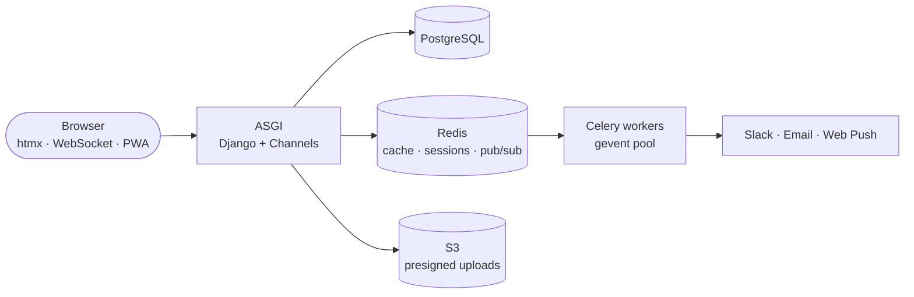

<div align="center">
  

  <p>
    <a href="https://iamhuzaifasabahuddin.github.io/Portfolio/"></a>
    <a href="mailto:huzaifasabah@gmail.com"></a>
    <a href="https://linkedin.com/in/huzaifa-sabah-uddin"></a>
    <a href="https://github.com/Iamhuzaifasabahuddin"></a>
  </p>

  <sub><a href="#-live-in-production">Live projects</a> · <a href="#-impact">Impact</a> · <a href="#-how-i-build">How I build</a> · <a href="#-tech-stack">Stack</a> · <a href="#-lets-build-something">Contact</a></sub>
</div>

<br />

```python
>>> from huzaifa import Engineer
>>> me = Engineer()
>>> me.role
'Backend Engineer & System Architect'
>>> me.live_in_production
['TopsoftDigitals Connect', 'Quillnest', 'BlinkDigitally']
>>> me.impact()
{'saas_savings': '$15.6K/yr', 'cost_reduction': '94%', 'revenue_protected': '$92.9K'}
>>> me.deadline_record
'100%: zero missed'
>>> me.motto
'Build systems, not just code. Automate workflows, not just tasks.'
```

---

## 🚀 Live in Production

> Real software, real users, running today. Click through and see it.

<table>
<tr>
<td>

### `01` &nbsp;⚡ TopsoftDigitals Connect
**Real-time project management platform for an agency: workspaces → clients → teams → tasks.**

<a href="https://production.topsoftdigitals.pk/"></a>

Built to replace Basecamp, Asana, Trello and a pile of Slack bots with **one in-house engine**, cutting tooling spend from **$1,400/mo to $90/mo** (94%) and saving **$15.6K/year**.

- **Real-time everywhere:** WebSocket notifications over Django Channels + Redis pub/sub, Web Push (VAPID) desktop alerts, and a 1:1 live chat with keyset pagination and reconnect handling
- **Approval-orchestrated workflow:** tasks move pending → awaiting approval → completed; clients auto-archive when their work is done
- **8-role RBAC** (admin, manager, PM, marketing, designer, developer, editor, publisher) scoped per workspace
- **Slack hub:** signature-verified slash commands (`/tasks`, `/requests`), batched DM delivery for every notification type, a daily pending-task digest
- **Support tickets with SLA clocks** per priority, breach highlighting and hourly escalation
- **Email alert scanner:** IMAP + Celery flags chargeback/refund/complaint mail with a 438-keyword single-pass regex
- **Sales & payments ledger**, `Ctrl+K` command palette, Asana import, installable PWA
- **Built for speed:** versioned Redis fragment caching with singleflight, zero N+1 in audited views, Brotli-compressed HTML (~70–80% smaller), presigned S3 uploads up to 500 MB, ~780 tests plus Locust and k6 load scenarios

        

</td>
</tr>
<tr>
<td>

### `02` &nbsp;🪶 Quillnest · Client Portal
**One shared workspace for a publishing-services team and its clients.** Conversation, files, deliverables, approvals and signed agreements for every project, in one place.

<a href="https://usequillnest.com/"></a>

Runs **several publishing brands from a single Django app**. Staff see every brand; each client sees only their own brand and their own projects. The guiding idea: *nothing waits unnoticed*.

- **Client approvals:** deliverables complete only when the client approves; answers are final and the files shown are stored as immutable copies. Unanswered requests get reminders at 3 and 7 days
- **Built-in e-sign:** versioned terms, a signing audit trail (name, IP, timestamp, user agent, content hash) and a generated **PDF certificate**
- **"Whose move is it?"** A *Today* view ranks projects by who needs to act; a daily *Digest* surfaces clients who've gone quiet
- **Live chat & notifications** over WebSockets with an HTTP fallback; staff aliases so clients never see internal names
- **File versioning & previews:** image/PDF thumbnails decoded at reduced scale to keep memory low; direct-to-S3 browser uploads
- **No build step:** server-rendered templates + htmx, installable PWA, light/dark theme, `Ctrl+K` palette
- **1,000+ tests** covering access rules, caching, approvals, agreements and live-update paths

       

</td>
</tr>
<tr>
<td>

### `03` &nbsp;📊 BlinkDigitally · Publishing Dashboard
**Production analytics platform (~6,000 LOC) that saves an editorial team 12+ hours a week of manual reporting.**

<a href="https://github.com/Iamhuzaifasabahuddin/BlinkDigitally"></a>

- Real-time data from the Google Sheets API, aggregated across 7 sheets (USA, UK, Audio, Printing, Copyright, A+, Sales)
- Interactive Plotly visualisations, duplicate-client detection, Excel/PDF report generation
- Intelligent caching to keep a large multi-sheet dataset fast

    

</td>
</tr>
</table>

---

## 📈 Impact

<div align="center">
  <table>
    <tr>
      <td align="center" width="220"><h2>$15.6K</h2><sub>saved per year in SaaS licensing</sub></td>
      <td align="center" width="220"><h2>94%</h2><sub>tooling cost cut<br/>$1,400/mo → $90/mo</sub></td>
      <td align="center" width="220"><h2>$92.9K</h2><sub>revenue protected<br/>across 44 disputes</sub></td>
    </tr>
    <tr>
      <td align="center" width="220"><h2>5 → 1</h2><sub>tools replaced by a single engine</sub></td>
      <td align="center" width="220"><h2>1,700+</h2><sub>automated tests across<br/>the two live platforms</sub></td>
      <td align="center" width="220"><h2>100%</h2><sub>deadline record<br/>zero missed</sub></td>
    </tr>
  </table>
</div>

---

## 🧭 How I Build



| Principle | What it looks like in practice |
|---|---|
| **Real-time by default** | WebSockets for live updates, with HTTP fallbacks so nothing breaks when a socket drops |
| **Heavy work goes async** | Emails, Slack DMs, scans and exports run in Celery, so requests stay fast |
| **Cache with intent** | Versioned keys bumped on write, TTL jitter, singleflight against stampedes |
| **Lean front end** | Server-rendered HTML + htmx, no SPA build pipeline to maintain |
| **Secure by design** | Role-scoped access rules, rate limits on every POST, sanitised rich text, signed webhooks |
| **Tested, then shipped** | Large isolated test suites, load tests, CI that blocks on missing migrations |

---

## 🛠 Tech Stack

<div align="center">

**Languages**<br/>


**Backend & Frameworks**<br/>


**Data, Async & Messaging**<br/>


**DevOps & Cloud**<br/>


</div>

---

## 📊 GitHub Analytics

<div align="center">
  
</div>
<div align="center">
  
  
  
</div>

---

## 🔭 Currently Exploring

<div align="center">
  
  
  
  
  
</div>

Event-driven architectures with Kafka and RabbitMQ · Kubernetes orchestration · microservice boundaries and scalable APIs · cloud-native deployment on AWS and GCP.

---

## 🤝 Let's Build Something

<div align="center">

I take products from **idea to production**: architecture, backend, real-time features, automation and deployment.<br/>
Open to freelance work, collaborations and technical discussions.

<a href="https://iamhuzaifasabahuddin.github.io/Portfolio/"></a>
<a href="mailto:huzaifasabah@gmail.com"></a>
<a href="https://linkedin.com/in/huzaifa-sabah-uddin"></a>

<br/><br/>

<br/>
<sub>Last updated: November 2026</sub>

</div>
